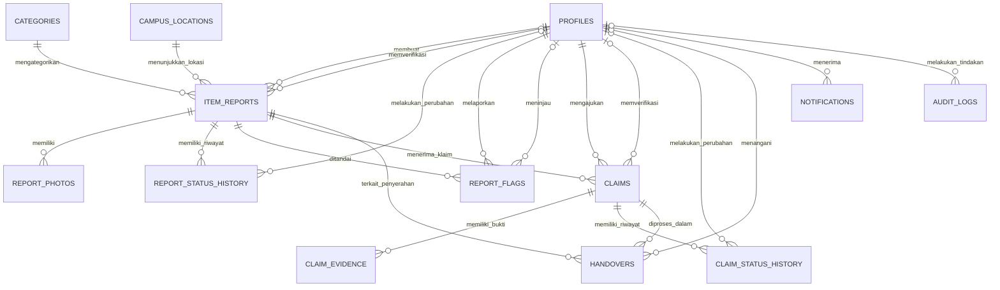

# ERD Lost&Found — Sistem Informasi Barang Hilang dan Temuan Kampus

Untuk website **Lost&Found**, ERD (Entity Relationship Diagram) harus menggambarkan proses bisnis secara utuh, mulai dari mahasiswa membuat laporan, admin memverifikasi laporan, pengguna mengajukan klaim kepemilikan, sampai barang benar-benar dikembalikan.

ERD ini dirancang untuk MVP yang bisa dikembangkan menjadi website sungguhan, bukan sekadar diagram untuk tugas IMK.

Ada satu keputusan penting: **laporan barang hilang, laporan barang temuan, klaim kepemilikan, dan pengembalian barang harus dipisahkan menjadi entitas yang berbeda.** Dengan begitu, status laporan tidak tercampur dengan status klaim, dan sistem bisa mencatat riwayat pengembalian dengan jelas.

## 1. Entitas utama dalam ERD

ERD Lost&Found terdiri dari 13 entitas inti:

| No. | Entitas                 | Fungsi                                                       |
| --: | ----------------------- | ------------------------------------------------------------ |
|   1 | `profiles`              | Menyimpan profil mahasiswa dan admin.                        |
|   2 | `categories`            | Menyimpan kategori barang.                                   |
|   3 | `campus_locations`      | Menyimpan daftar lokasi di lingkungan kampus.                |
|   4 | `item_reports`          | Menyimpan laporan barang hilang dan barang temuan.           |
|   5 | `report_photos`         | Menyimpan referensi foto laporan.                            |
|   6 | `report_status_history` | Mencatat perubahan status laporan.                           |
|   7 | `report_flags`          | Mencatat laporan konten mencurigakan.                        |
|   8 | `claims`                | Menyimpan pengajuan klaim kepemilikan barang.                |
|   9 | `claim_evidence`        | Menyimpan bukti pendukung klaim.                             |
|  10 | `claim_status_history`  | Mencatat perubahan status klaim.                             |
|  11 | `handovers`             | Mencatat proses penyerahan barang.                           |
|  12 | `notifications`         | Menyimpan notifikasi untuk pengguna.                         |
|  13 | `audit_logs`            | Mencatat tindakan penting yang dilakukan pengguna dan admin. |

ERD ini juga menggunakan tabel profil yang terpisah dari autentikasi Supabase. Dengan demikian, data profil aplikasi tidak perlu menyimpan password pengguna.

## 2. Diagram ERD keseluruhan

Berikut gambaran hubungan antartabel. Diagram ini menggunakan notasi Crow's Foot: `||` berarti tepat satu, `o|` berarti nol atau satu, dan `o{` berarti nol atau banyak.



**Catatan penting:** Diagram di atas menggambarkan relasi dasar. Aturan seperti hanya mengizinkan klaim atas barang temuan harus diterapkan melalui validasi database atau backend. Relasi biasa tidak otomatis menjamin bahwa laporan yang diklaim bertipe `FOUND`.

Untuk implementasi yang lebih aman, gunakan `auth.users` milik Supabase sebagai sumber identitas autentikasi dan `profiles.id` sebagai foreign key yang mengarah ke `auth.users.id`.

---

# 3. Detail struktur tabel dan kolom

## A. Tabel `profiles`

**Fungsi:** Menyimpan informasi profil pengguna, baik mahasiswa maupun admin.

| Kolom        | Tipe PostgreSQL | Constraint                  | Keterangan                 |
| ------------ | --------------- | --------------------------- | -------------------------- |
| `id`         | UUID            | PK, FK                      | Mengacu ke `auth.users.id` |
| `full_name`  | VARCHAR(100)    | NOT NULL                    | Nama lengkap pengguna      |
| `email`      | VARCHAR(255)    | NOT NULL                    | Email pengguna             |
| `student_id` | VARCHAR(30)     | UNIQUE, NULL                | NIM jika diperlukan        |
| `role`       | VARCHAR(20)     | NOT NULL, DEFAULT `STUDENT` | Role pengguna              |
| `avatar_url` | TEXT            | NULL                        | Referensi foto profil      |
| `created_at` | TIMESTAMPTZ     | NOT NULL                    | Waktu profil dibuat        |
| `updated_at` | TIMESTAMPTZ     | NOT NULL                    | Waktu profil diperbarui    |

**Nilai `role`:**

- `STUDENT`
- `ADMIN`

**Relasi:**

- Satu profil dapat membuat banyak laporan.
- Satu profil dapat mengajukan banyak klaim.
- Satu profil dapat menerima banyak notifikasi.
- Satu profil admin dapat memverifikasi banyak laporan dan klaim.

**Catatan keamanan:** Pengguna tidak boleh bisa mengubah `role` miliknya sendiri menjadi `ADMIN`. Perubahan role harus dibatasi melalui mekanisme administratif yang tepercaya. Password tidak disimpan di tabel ini.

## B. Tabel `categories`

**Fungsi:** Menyimpan kategori barang agar pencarian dan pengelompokan lebih mudah.

| Kolom         | Tipe         | Constraint             | Keterangan                          |
| ------------- | ------------ | ---------------------- | ----------------------------------- |
| `id`          | BIGINT       | PK, IDENTITY           | ID kategori                         |
| `name`        | VARCHAR(80)  | UNIQUE, NOT NULL       | Nama kategori                       |
| `slug`        | VARCHAR(100) | UNIQUE, NOT NULL       | Identitas kategori untuk URL/filter |
| `description` | TEXT         | NULL                   | Penjelasan kategori                 |
| `is_active`   | BOOLEAN      | NOT NULL, DEFAULT TRUE | Kategori tersedia atau tidak        |
| `created_at`  | TIMESTAMPTZ  | NOT NULL               | Waktu dibuat                        |

Contoh data:

|  id | name                 | slug             |
| --: | -------------------- | ---------------- |
|   1 | Elektronik           | elektronik       |
|   2 | Dompet dan Uang      | dompet-uang      |
|   3 | Kartu Identitas      | kartu-identitas  |
|   4 | Tas                  | tas              |
|   5 | Alat Tulis           | alat-tulis       |
|   6 | Kunci                | kunci            |
|   7 | Pakaian dan Aksesori | pakaian-aksesori |
|   8 | Lainnya              | lainnya          |

Relasi: satu kategori dapat digunakan oleh banyak laporan.

## C. Tabel `campus_locations`

**Fungsi:** Menyimpan lokasi umum di lingkungan kampus. Pengguna dapat memilih lokasi dari daftar yang tersedia daripada mengetik lokasi secara bebas.

| Kolom         | Tipe          | Constraint             | Keterangan                        |
| ------------- | ------------- | ---------------------- | --------------------------------- |
| `id`          | BIGINT        | PK, IDENTITY           | ID lokasi                         |
| `name`        | VARCHAR(100)  | NOT NULL               | Nama area atau gedung             |
| `building`    | VARCHAR(100)  | NULL                   | Nama gedung                       |
| `description` | TEXT          | NULL                   | Keterangan tambahan               |
| `latitude`    | NUMERIC(10,7) | NULL                   | Koordinat lintang jika diperlukan |
| `longitude`   | NUMERIC(10,7) | NULL                   | Koordinat bujur jika diperlukan   |
| `is_active`   | BOOLEAN       | NOT NULL, DEFAULT TRUE | Lokasi masih digunakan            |
| `created_at`  | TIMESTAMPTZ   | NOT NULL               | Waktu dibuat                      |

Contoh data:

- Perpustakaan.
- Gedung Fakultas.
- Laboratorium Komputer.
- Kantin.
- Area Parkir.
- Auditorium.
- Masjid Kampus.

**Keputusan desain:** Untuk MVP, gunakan lokasi umum. Jangan mewajibkan koordinat GPS yang presisi karena tidak selalu diperlukan untuk menemukan barang dan dapat menimbulkan risiko privasi.

## D. Tabel `item_reports`

**Fungsi:** Tabel utama yang menyimpan seluruh laporan barang hilang dan barang temuan.

Ini merupakan tabel inti karena pencarian, filter, dashboard pengguna, dan verifikasi admin bergantung pada data di dalamnya.

| Kolom                | Tipe         | Constraint       | Keterangan                                 |
| -------------------- | ------------ | ---------------- | ------------------------------------------ |
| `id`                 | UUID         | PK               | ID internal laporan                        |
| `report_number`      | VARCHAR(30)  | UNIQUE, NOT NULL | Nomor laporan yang ditampilkan ke pengguna |
| `user_id`            | UUID         | FK, NOT NULL     | Pembuat laporan                            |
| `report_type`        | VARCHAR(10)  | NOT NULL         | Jenis laporan                              |
| `item_name`          | VARCHAR(150) | NOT NULL         | Nama atau jenis barang                     |
| `category_id`        | BIGINT       | FK, NOT NULL     | Kategori barang                            |
| `description_public` | TEXT         | NOT NULL         | Deskripsi yang boleh dipublikasikan        |
| `date_occurred`      | DATE         | NOT NULL         | Tanggal barang hilang atau ditemukan       |
| `location_id`        | BIGINT       | FK, NOT NULL     | Lokasi umum kejadian                       |
| `dropoff_location_id`| BIGINT       | FK, NULL         | Lokasi penyerahan untuk laporan `FOUND`    |
| `contact_preference` | VARCHAR(20)  | NULL             | Jenis kontak yang dipilih pelapor          |
| `contact_value`      | TEXT         | NULL             | Nilai kontak (privat, tidak dipublikasikan)|
| `report_status`      | VARCHAR(20)  | NOT NULL         | Status laporan                             |
| `created_at`         | TIMESTAMPTZ  | NOT NULL         | Waktu laporan dibuat                       |
| `updated_at`         | TIMESTAMPTZ  | NOT NULL         | Waktu terakhir diperbarui                  |
| `reviewed_by`        | UUID         | FK, NULL         | Admin yang memverifikasi                   |
| `reviewed_at`        | TIMESTAMPTZ  | NULL             | Waktu verifikasi                           |
| `rejection_reason`   | TEXT         | NULL             | Alasan laporan ditolak                     |

### Nilai `report_type`

| Nilai   | Makna                      |
| ------- | -------------------------- |
| `LOST`  | Pengguna kehilangan barang |
| `FOUND` | Pengguna menemukan barang  |

Keduanya disimpan dalam satu tabel karena memiliki banyak atribut yang sama, seperti nama, kategori, tanggal, lokasi, dan foto.

### Nilai `report_status`

| Nilai            | Makna                        |
| ---------------- | ---------------------------- |
| `PENDING`        | Menunggu verifikasi          |
| `NEEDS_REVISION` | Memerlukan perbaikan         |
| `ACTIVE`         | Disetujui dan dipublikasikan |
| `REJECTED`       | Ditolak                      |
| `CLOSED`         | Laporan ditutup              |

Status barang yang dikembalikan sebaiknya tidak hanya bergantung pada `report_status`. Proses pengembalian perlu dicatat dalam tabel `handovers` dan status klaim agar laporan, klaim, serta penyerahan tidak tercampur.

### Foreign key

- `user_id` → `profiles.id`
- `category_id` → `categories.id`
- `location_id` → `campus_locations.id`
- `dropoff_location_id` → `campus_locations.id`
- `reviewed_by` → `profiles.id`

### Catatan privasi kontak

`contact_value` hanya boleh dibaca oleh pemilik laporan dan admin. Kolom ini tidak boleh disertakan pada query publik maupun view yang dipakai halaman pencarian. Nilai `contact_preference` menggunakan `EMAIL`, `WHATSAPP`, atau `NONE`.

### Contoh data

| report_number | report_type | item_name       | report_status |
| ------------- | ----------- | --------------- | ------------- |
| LF-2026-0001  | LOST        | Dompet hitam    | ACTIVE        |
| LF-2026-0002  | FOUND       | Tumbler biru    | ACTIVE        |
| LF-2026-0003  | FOUND       | Kartu mahasiswa | PENDING       |

Nomor laporan hanya contoh. Dalam implementasi, buat generator nomor yang aman terhadap duplikasi, misalnya dengan sequence atau mekanisme database lainnya.

## E. Tabel `report_photos`

**Fungsi:** Menyimpan foto yang berkaitan dengan laporan barang.

Foto dipisahkan dari `item_reports` agar satu laporan dapat memiliki beberapa foto tanpa membuat banyak kolom seperti `photo_1`, `photo_2`, dan `photo_3`.

| Kolom          | Tipe         | Constraint              | Keterangan                    |
| -------------- | ------------ | ----------------------- | ----------------------------- |
| `id`           | UUID         | PK                      | ID foto                       |
| `report_id`    | UUID         | FK, NOT NULL            | Laporan terkait               |
| `storage_path` | TEXT         | NOT NULL                | Path file di Supabase Storage |
| `alt_text`     | VARCHAR(200) | NULL                    | Deskripsi gambar              |
| `is_primary`   | BOOLEAN      | NOT NULL, DEFAULT FALSE | Foto utama                    |
| `sort_order`   | SMALLINT     | NOT NULL, DEFAULT 0     | Urutan foto                   |
| `created_at`   | TIMESTAMPTZ  | NOT NULL                | Waktu unggah                  |

**Relasi:** Satu laporan dapat memiliki banyak foto.

**Aturan bisnis:**

- Satu laporan boleh tidak memiliki foto jika foto bersifat opsional.
- Maksimal satu foto utama per laporan.
- Foto harus divalidasi tipe dan ukuran filenya.
- File tidak disimpan sebagai data biner langsung di PostgreSQL; database menyimpan referensi ke file di Storage.

Untuk keamanan, foto yang memuat informasi sensitif harus disimpan dengan kontrol akses yang sesuai. Foto bukti kepemilikan tidak boleh dicampur dengan foto publik laporan.

## F. Tabel `report_status_history`

**Fungsi:** Mencatat seluruh perubahan status laporan.

Tanpa tabel ini, sistem hanya mengetahui status terbaru. Sistem tidak dapat menjawab dengan baik siapa yang mengubah status, kapan perubahan terjadi, dan apa alasan perubahan tersebut.

| Kolom        | Tipe        | Constraint   | Keterangan                                   |
| ------------ | ----------- | ------------ | -------------------------------------------- |
| `id`         | BIGINT      | PK, IDENTITY | ID riwayat                                   |
| `report_id`  | UUID        | FK, NOT NULL | Laporan terkait                              |
| `old_status` | VARCHAR(20) | NULL         | Status sebelumnya                            |
| `new_status` | VARCHAR(20) | NOT NULL     | Status baru                                  |
| `changed_by` | UUID        | FK, NULL     | Pengguna atau admin yang melakukan perubahan |
| `reason`     | TEXT        | NULL         | Alasan perubahan                             |
| `created_at` | TIMESTAMPTZ | NOT NULL     | Waktu perubahan                              |

**Contoh riwayat:**

| old_status     | new_status     | reason                       |
| -------------- | -------------- | ---------------------------- |
| NULL           | PENDING        | Laporan baru dikirim         |
| PENDING        | NEEDS_REVISION | Foto kurang jelas            |
| NEEDS_REVISION | PENDING        | Pengguna memperbaiki laporan |
| PENDING        | ACTIVE         | Laporan disetujui admin      |

Relasi:

- Satu laporan memiliki banyak catatan riwayat.
- Satu profil dapat melakukan banyak perubahan status.

Untuk memastikan riwayat dapat dipercaya, pencatatan perubahan status sebaiknya dilakukan secara otomatis melalui transaksi database atau mekanisme backend yang terkontrol.

---

## F2. Tabel `report_flags`

**Fungsi:** Mencatat laporan atau konten yang ditandai mencurigakan oleh pengguna agar dapat ditinjau admin.

Tabel ini menjawab kebutuhan menu **Laporan Mencurigakan** pada PRD §5.2 dan §13.2, yang tidak bisa direpresentasikan hanya dengan `audit_logs` karena flag dibuat oleh pengguna, bukan oleh admin.

| Kolom         | Tipe        | Constraint             | Keterangan                     |
| ------------- | ----------- | ---------------------- | ------------------------------ |
| `id`          | UUID        | PK                     | ID flag                        |
| `report_id`   | UUID        | FK, NOT NULL           | Laporan yang ditandai          |
| `reporter_id` | UUID        | FK, NOT NULL           | Pengguna yang menandai         |
| `reason`      | TEXT        | NOT NULL               | Alasan penandaan               |
| `flag_status` | VARCHAR(20) | NOT NULL, DEFAULT `OPEN` | Status peninjauan            |
| `reviewed_by` | UUID        | FK, NULL               | Admin yang meninjau            |
| `reviewed_at` | TIMESTAMPTZ | NULL                   | Waktu peninjauan               |
| `created_at`  | TIMESTAMPTZ | NOT NULL               | Waktu flag dibuat              |

### Nilai `flag_status`

| Nilai       | Makna                     |
| ----------- | ------------------------- |
| `OPEN`      | Menunggu peninjauan       |
| `REVIEWED`  | Sudah ditinjau            |
| `DISMISSED` | Diabaikan (tidak terbukti)|

### Aturan bisnis

1. Satu pengguna hanya boleh menandai satu laporan satu kali (`UNIQUE (report_id, reporter_id)`).
2. Flag tidak boleh dibuat oleh pembuat laporan itu sendiri.
3. Flag tidak otomatis menurunkan status laporan; admin yang memutuskan.
4. Alasan flag wajib diisi.

**Relasi:**

- Satu laporan dapat memiliki banyak flag.
- Satu pengguna dapat membuat banyak flag.
- Satu admin dapat meninjau banyak flag.

---

## G. Tabel `claims`

**Fungsi:** Menyimpan pengajuan klaim oleh seseorang yang merasa sebagai pemilik barang temuan.

Tabel ini penting karena **satu barang temuan dapat memiliki lebih dari satu pengajuan klaim**. Sistem harus bisa memeriksa setiap klaim tanpa mencampur identitas pemilik laporan dengan identitas calon pemilik barang.

| Kolom                   | Tipe        | Constraint       | Keterangan                                  |
| ----------------------- | ----------- | ---------------- | ------------------------------------------- |
| `id`                    | UUID        | PK               | ID klaim                                    |
| `claim_number`          | VARCHAR(30) | UNIQUE, NOT NULL | Nomor klaim                                 |
| `item_report_id`        | UUID        | FK, NOT NULL     | Laporan barang yang diklaim                 |
| `claimant_id`           | UUID        | FK, NOT NULL     | Pengguna yang mengajukan                    |
| `ownership_description` | TEXT        | NOT NULL         | Penjelasan mengapa barang diyakini miliknya |
| `claim_status`          | VARCHAR(20) | NOT NULL         | Status klaim                                |
| `admin_notes`           | TEXT        | NULL             | Catatan internal admin                      |
| `reviewed_by`           | UUID        | FK, NULL         | Admin pemeriksa                             |
| `reviewed_at`           | TIMESTAMPTZ | NULL             | Waktu pemeriksaan                           |
| `rejection_reason`      | TEXT        | NULL             | Alasan penolakan                            |
| `created_at`            | TIMESTAMPTZ | NOT NULL         | Waktu pengajuan                             |
| `updated_at`            | TIMESTAMPTZ | NOT NULL         | Waktu pembaruan                             |

### Nilai `claim_status`

| Nilai       | Makna                     |
| ----------- | ------------------------- |
| `PENDING`   | Menunggu verifikasi       |
| `IN_REVIEW` | Sedang diperiksa          |
| `APPROVED`  | Klaim disetujui           |
| `REJECTED`  | Klaim ditolak             |
| `COMPLETED` | Penyerahan barang selesai |
| `CANCELLED` | Klaim dibatalkan          |

### Relasi

- Satu laporan barang temuan dapat memiliki banyak klaim.
- Satu pengguna dapat mengajukan banyak klaim.
- Satu admin dapat memeriksa banyak klaim.

### Aturan bisnis

1. Klaim hanya dapat diajukan untuk laporan dengan `report_type = 'FOUND'`.
2. Pengguna tidak dapat mengklaim laporan barang temuan miliknya sendiri.
3. Klaim harus diperiksa sebelum disetujui.
4. Alasan penolakan harus disimpan jika klaim ditolak.
5. Klaim yang disetujui tidak otomatis berarti barang sudah dikembalikan.
6. Sistem harus mencegah persetujuan beberapa klaim yang saling bertentangan untuk satu barang.
7. Bukti kepemilikan tidak boleh ditampilkan secara publik.

Aturan pertama dan kedua membutuhkan validasi tambahan karena foreign key biasa hanya memastikan bahwa laporan dan pengguna yang dirujuk memang ada.

## H. Tabel `claim_evidence`

**Fungsi:** Menyimpan bukti pendukung pengajuan klaim, misalnya foto pribadi barang, bukti pembelian, atau informasi ciri khusus.

| Kolom           | Tipe        | Constraint   | Keterangan       |
| --------------- | ----------- | ------------ | ---------------- |
| `id`            | UUID        | PK           | ID bukti         |
| `claim_id`      | UUID        | FK, NOT NULL | Klaim terkait    |
| `storage_path`  | TEXT        | NOT NULL     | Path file bukti  |
| `evidence_type` | VARCHAR(30) | NOT NULL     | Jenis bukti      |
| `description`   | TEXT        | NULL         | Keterangan bukti |
| `created_at`    | TIMESTAMPTZ | NOT NULL     | Waktu unggah     |

Contoh `evidence_type`:

- `PHOTO`
- `PURCHASE_PROOF`
- `OWNERSHIP_DOCUMENT`
- `OTHER`

**Relasi:** Satu klaim dapat memiliki beberapa bukti.

**Catatan keamanan:** File bukti harus berada di lokasi penyimpanan privat. Hanya pengaju klaim dan petugas yang memiliki kewenangan yang boleh mengaksesnya sesuai kebijakan sistem. URL file yang bersifat publik tidak cocok untuk bukti kepemilikan.

## I. Tabel `claim_status_history`

**Fungsi:** Menyimpan riwayat perubahan status klaim.

| Kolom        | Tipe        | Constraint   | Keterangan                                   |
| ------------ | ----------- | ------------ | -------------------------------------------- |
| `id`         | BIGINT      | PK, IDENTITY | ID riwayat                                   |
| `claim_id`   | UUID        | FK, NOT NULL | Klaim terkait                                |
| `old_status` | VARCHAR(20) | NULL         | Status sebelumnya                            |
| `new_status` | VARCHAR(20) | NOT NULL     | Status baru                                  |
| `changed_by` | UUID        | FK, NULL     | Pengguna atau admin yang melakukan perubahan |
| `reason`     | TEXT        | NULL         | Alasan perubahan                             |
| `created_at` | TIMESTAMPTZ | NOT NULL     | Waktu perubahan                              |

Contoh alur:

```text
PENDING
   ↓
IN_REVIEW
   ↓
APPROVED
   ↓
COMPLETED
```

Alternatif:

```text
PENDING
   ↓
IN_REVIEW
   ↓
REJECTED
```

Status `COMPLETED` baru diberikan setelah penyerahan dikonfirmasi. Perubahan status harus mengikuti aturan transisi yang diizinkan.

---

## J. Tabel `handovers`

**Fungsi:** Mencatat proses penyerahan barang kepada pihak yang telah lolos verifikasi.

Kenapa tabel ini terpisah dari `claims`?

Karena persetujuan klaim dan penyerahan barang merupakan dua peristiwa berbeda. Seseorang dapat dinyatakan sebagai pemilik yang sah, tetapi barang belum tentu langsung diserahkan pada saat yang sama.

| Kolom                | Tipe        | Constraint   | Keterangan               |
| -------------------- | ----------- | ------------ | ------------------------ |
| `id`                 | UUID        | PK           | ID penyerahan            |
| `item_report_id`     | UUID        | FK, NOT NULL | Laporan barang           |
| `claim_id`           | UUID        | FK, NOT NULL | Klaim yang disetujui     |
| `handled_by`         | UUID        | FK, NULL     | Petugas yang menangani   |
| `handover_location`  | TEXT        | NOT NULL     | Lokasi penyerahan        |
| `handover_status`    | VARCHAR(20) | NOT NULL     | Status penyerahan        |
| `scheduled_at`       | TIMESTAMPTZ | NULL         | Jadwal penyerahan        |
| `completed_at`       | TIMESTAMPTZ | NULL         | Waktu penyerahan selesai |
| `confirmation_notes` | TEXT        | NULL         | Catatan konfirmasi       |
| `created_at`         | TIMESTAMPTZ | NOT NULL     | Waktu pencatatan         |

### Nilai `handover_status`

| Nilai       | Makna                   |
| ----------- | ----------------------- |
| `SCHEDULED` | Penyerahan dijadwalkan  |
| `COMPLETED` | Barang telah diserahkan |
| `CANCELLED` | Penyerahan dibatalkan   |

**Aturan penting:**

- Klaim harus berstatus `APPROVED` sebelum penyerahan dijadwalkan.
- Penyerahan yang selesai harus memiliki waktu penyelesaian.
- Penyerahan harus terhubung ke laporan dan klaim yang sama.
- Klaim tidak boleh dianggap selesai hanya karena jadwal penyerahan telah dibuat.

Untuk MVP, satu klaim yang disetujui dapat memiliki satu proses penyerahan aktif. Jika proses penyerahan perlu dijadwalkan ulang, riwayatnya harus tetap dapat dilacak.

## K. Tabel `notifications`

**Fungsi:** Menyimpan notifikasi kepada pengguna mengenai aktivitas yang relevan.

| Kolom               | Tipe         | Constraint   | Keterangan              |
| ------------------- | ------------ | ------------ | ----------------------- |
| `id`                | UUID         | PK           | ID notifikasi           |
| `user_id`           | UUID         | FK, NOT NULL | Penerima                |
| `title`             | VARCHAR(150) | NOT NULL     | Judul notifikasi        |
| `message`           | TEXT         | NOT NULL     | Isi notifikasi          |
| `notification_type` | VARCHAR(40)  | NOT NULL     | Jenis notifikasi        |
| `related_report_id` | UUID         | FK, NULL     | Laporan terkait         |
| `related_claim_id`  | UUID         | FK, NULL     | Klaim terkait           |
| `read_at`           | TIMESTAMPTZ  | NULL         | Waktu notifikasi dibaca |
| `created_at`        | TIMESTAMPTZ  | NOT NULL     | Waktu notifikasi dibuat |

Contoh notifikasi:

- Laporan barang berhasil dikirim.
- Laporan barang telah disetujui.
- Laporan perlu diperbaiki.
- Klaim sedang diperiksa.
- Klaim telah disetujui.
- Jadwal penyerahan barang telah ditentukan.
- Barang telah dikembalikan.

Notifikasi hanya memberikan informasi yang relevan kepada penerima dan tidak boleh membocorkan bukti kepemilikan atau data pribadi pihak lain.

## L. Tabel `audit_logs`

**Fungsi:** Mencatat aktivitas penting untuk kebutuhan keamanan dan pemeriksaan administratif.

| Kolom         | Tipe        | Constraint   | Keterangan                       |
| ------------- | ----------- | ------------ | -------------------------------- |
| `id`          | BIGINT      | PK, IDENTITY | ID log                           |
| `actor_id`    | UUID        | FK, NULL     | Pengguna yang melakukan tindakan |
| `entity_type` | VARCHAR(40) | NOT NULL     | Jenis entitas                    |
| `entity_id`   | UUID        | NOT NULL     | ID entitas terkait               |
| `action`      | VARCHAR(60) | NOT NULL     | Jenis tindakan                   |
| `old_value`   | JSONB       | NULL         | Data lama yang relevan           |
| `new_value`   | JSONB       | NULL         | Data baru yang relevan           |
| `reason`      | TEXT        | NULL         | Alasan tindakan jika relevan     |
| `created_at`  | TIMESTAMPTZ | NOT NULL     | Waktu tindakan                   |

Contoh tindakan:

- `REPORT_APPROVED`
- `REPORT_REJECTED`
- `CLAIM_APPROVED`
- `CLAIM_REJECTED`
- `HANDOVER_COMPLETED`
- `USER_ROLE_CHANGED`

Kolom `entity_id` bersifat polimorfik karena dapat mengarah ke tabel berbeda. Karena itu, kolom ini tidak menggunakan satu foreign key biasa. Jika integritas referensi log harus dijamin sepenuhnya, pertimbangkan tabel audit khusus per entitas atau desain audit yang sesuai.

Audit log harus dibatasi agar pengguna biasa tidak dapat mengubah atau menghapus catatan aktivitas administratif.

---

## M. View `item_report_status`

**Fungsi:** Menyatukan status laporan dengan status klaim dan penyerahan menjadi satu status tampilan untuk barang temuan, sesuai PRD §9.2.

Status ini **tidak disimpan sebagai kolom** karena nilainya dapat berubah mengikuti klaim dan penyerahan. Menyimpannya sebagai kolom berisiko menimbulkan data ganda yang saling bertentangan.

| Status Tampilan     | Kondisi                                                                 |
| ------------------- | ----------------------------------------------------------------------- |
| `Menunggu Verifikasi`| `report_status = 'PENDING'`                                            |
| `Perlu Perbaikan`   | `report_status = 'NEEDS_REVISION'`                                      |
| `Ditolak`           | `report_status = 'REJECTED'`                                            |
| `Tersedia`          | `report_type = 'FOUND'`, `report_status = 'ACTIVE'`, belum ada klaim aktif |
| `Ada Klaim`         | Ada klaim berstatus `PENDING` atau `IN_REVIEW`                          |
| `Siap Diserahkan`   | Ada klaim berstatus `APPROVED`                                          |
| `Dikembalikan`      | Ada `handovers` berstatus `COMPLETED`                                   |
| `Ditutup`           | `report_status = 'CLOSED'`                                              |

Urutan evaluasi dilakukan dari kondisi paling akhir (penyerahan selesai) ke kondisi awal agar tidak terjadi konflik status.

---

# 4. Ringkasan relasi dan kardinalitas

Bagian ini penting untuk menjelaskan ERD saat presentasi tugas IMK atau basis data.

| No. | Entitas pertama    | Relasi                  | Entitas kedua           | Kardinalitas |
| --: | ------------------ | ----------------------- | ----------------------- | ------------ |
|   1 | `profiles`         | Membuat                 | `item_reports`          | 1 : N        |
|   2 | `categories`       | Mengategorikan          | `item_reports`          | 1 : N        |
|   3 | `campus_locations` | Menjadi lokasi          | `item_reports`          | 1 : N        |
|   4 | `item_reports`     | Memiliki foto           | `report_photos`         | 1 : N        |
|   5 | `profiles`         | Memverifikasi           | `item_reports`          | 1 : N        |
|   6 | `item_reports`     | Memiliki riwayat status | `report_status_history` | 1 : N        |
|   7 | `item_reports`     | Menerima klaim          | `claims`                | 1 : N        |
|   8 | `profiles`         | Mengajukan              | `claims`                | 1 : N        |
|   9 | `claims`           | Memiliki bukti          | `claim_evidence`        | 1 : N        |
|  10 | `claims`           | Memiliki riwayat status | `claim_status_history`  | 1 : N        |
|  11 | `item_reports`     | Terkait dengan          | `handovers`             | 1 : N        |
|  12 | `claims`           | Diproses melalui        | `handovers`             | 1 : N        |
|  13 | `profiles`         | Menerima                | `notifications`         | 1 : N        |
|  14 | `profiles`         | Melakukan tindakan      | `audit_logs`            | 1 : N        |
|  15 | `item_reports`     | Ditandai melalui        | `report_flags`          | 1 : N        |
|  16 | `profiles`         | Melaporkan              | `report_flags`          | 1 : N        |
|  17 | `profiles`         | Meninjau                | `report_flags`          | 1 : N        |

**Penjelasan kardinalitas:**

- **1 : N (One-to-Many):** Satu data pada tabel pertama dapat berhubungan dengan banyak data pada tabel kedua.
- **1 : 1 (One-to-One):** Satu data hanya berhubungan dengan satu data lain. Relasi ini belum menjadi relasi utama pada desain Lost&Found.
- **M : N (Many-to-Many):** Banyak data pada satu tabel dapat berhubungan dengan banyak data pada tabel lain. Jika hubungan ini diperlukan, biasanya dibuat tabel penghubung.

Perlu diingat bahwa kardinalitas di atas menggambarkan relasi dasar. Contohnya, meskipun satu klaim secara teknis dapat memiliki beberapa catatan penyerahan, kebijakan aplikasi dapat membatasi agar hanya ada satu penyerahan aktif untuk setiap klaim.

---

# 5. Aturan bisnis yang wajib diterapkan

ERD yang bagus tidak cukup hanya memiliki tabel dan foreign key. Ada aturan bisnis yang harus dijaga agar data tidak saling bertentangan.

### A. Aturan laporan

1. Setiap laporan dibuat oleh satu pengguna.
2. Setiap laporan memiliki satu kategori dan satu lokasi.
3. Laporan harus bertipe `LOST` atau `FOUND`.
4. Laporan baru tidak langsung dipublikasikan sebelum melewati proses verifikasi.
5. Hanya laporan yang disetujui yang boleh ditampilkan pada pencarian publik.
6. Pengguna hanya boleh mengubah laporan miliknya sesuai status dan kebijakan aplikasi.
7. `contact_value` hanya dapat dibaca pemilik laporan dan admin; tidak pernah tampil di halaman publik.
8. `dropoff_location_id` hanya relevan untuk laporan `FOUND` dan wajib jika titik layanan tersedia.

### A2. Aturan penandaan mencurigakan

1. Pengguna tidak boleh menandai laporannya sendiri.
2. Satu pengguna hanya boleh menandai satu laporan satu kali.
3. Flag tidak mengubah status laporan secara otomatis.
4. Hanya admin yang boleh menutup flag (`REVIEWED`/`DISMISSED`).

### B. Aturan klaim

1. Klaim hanya boleh diajukan terhadap laporan bertipe `FOUND`.
2. Pengaju klaim tidak boleh sama dengan pembuat laporan barang temuan.
3. Satu barang boleh memiliki beberapa klaim yang menunggu pemeriksaan.
4. Persetujuan klaim harus dilakukan oleh pihak yang berwenang.
5. Jika satu klaim telah disetujui, klaim lain yang bertentangan tidak boleh ikut disetujui tanpa penyelesaian konflik.
6. Informasi bukti kepemilikan hanya dapat diakses oleh pihak yang berwenang.

### C. Aturan pengembalian

1. Barang hanya dapat diserahkan setelah klaim disetujui.
2. Setiap penyerahan harus terhubung dengan laporan dan klaim yang sama.
3. Barang baru ditandai telah dikembalikan setelah penyerahan dikonfirmasi.
4. Perubahan status harus tercatat dalam riwayat.
5. Proses penyerahan yang dibatalkan tidak boleh membuat klaim otomatis menjadi selesai.

### D. Aturan keamanan

1. Password dikelola oleh Supabase Auth.
2. Pengguna tidak boleh menaikkan role-nya sendiri menjadi admin.
3. Bukti kepemilikan harus disimpan secara privat.
4. Hak akses diterapkan melalui Row Level Security (RLS) dan pemeriksaan backend.
5. Admin tidak boleh menghapus jejak perubahan status secara sembarangan.

---

# 6. Index database yang direkomendasikan

Index membantu mempercepat pencarian dan pengambilan data, khususnya ketika jumlah laporan bertambah.

| Tabel                   | Kolom                          | Tujuan                                 |
| ----------------------- | ------------------------------ | -------------------------------------- |
| `item_reports`          | `report_type, report_status`   | Filter jenis dan status laporan        |
| `item_reports`          | `category_id, report_status`   | Filter kategori                        |
| `item_reports`          | `location_id, report_status`   | Filter lokasi                          |
| `item_reports`          | `created_at DESC`              | Mengurutkan laporan terbaru            |
| `item_reports`          | `user_id, created_at DESC`     | Dashboard laporan pengguna             |
| `claims`                | `item_report_id, claim_status` | Melihat klaim berdasarkan barang       |
| `claims`                | `claimant_id, created_at DESC` | Melihat klaim pengguna                 |
| `report_status_history` | `report_id, created_at DESC`   | Mengambil riwayat laporan              |
| `claim_status_history`  | `claim_id, created_at DESC`    | Mengambil riwayat klaim                |
| `notifications`         | `user_id, created_at DESC`     | Mengambil notifikasi terbaru           |
| `notifications`         | `user_id, read_at`             | Memfilter notifikasi yang belum dibaca |
| `report_flags`          | `flag_status, created_at DESC` | Antrean peninjauan admin               |
| `report_flags`          | `report_id, reporter_id`       | Mencegah flag ganda                    |

Primary key dan kolom yang memiliki constraint `UNIQUE` umumnya sudah memiliki index. Karena itu, jangan membuat index tambahan yang identik tanpa alasan.

Untuk pencarian kata kunci pada `item_name` dan `description_public`, pertimbangkan PostgreSQL full-text search atau indeks trigram setelah kebutuhan pencarian diuji.

---

# 7. Catatan normalisasi database

Desain ini mengikuti prinsip normalisasi relasional.

### First Normal Form (1NF)

Setiap kolom menyimpan satu nilai, bukan daftar nilai sekaligus. Misalnya, foto disimpan dalam `report_photos`, bukan dalam satu kolom berisi beberapa URL yang dipisahkan koma.

### Second Normal Form (2NF)

Setiap atribut non-key bergantung pada keseluruhan primary key. Tabel-tabel inti menggunakan primary key tunggal sehingga tidak memiliki masalah ketergantungan parsial pada primary key komposit.

### Third Normal Form (3NF)

Data kategori, lokasi, profil, laporan, dan klaim dipisahkan berdasarkan tanggung jawabnya. Misalnya, nama kategori tidak perlu disalin berulang kali ke setiap laporan; laporan cukup menyimpan `category_id`.

Dengan struktur ini, perubahan nama kategori tidak mengharuskan semua laporan diperbarui.

---

# 8. Saran implementasi untuk Supabase

Sebelum mulai coding, ada beberapa hal yang perlu dipastikan.

**Pertama, buat tabel sesuai urutan dependensi.** Mulai dari `profiles`, `categories`, dan `campus_locations`, kemudian `item_reports`, lalu tabel foto, klaim, riwayat, penyerahan, notifikasi, dan audit log.

**Kedua, terapkan RLS pada semua tabel yang berisi data pengguna.** Contohnya:

- Mahasiswa hanya dapat melihat dan mengubah laporan miliknya sesuai kebijakan.
- Laporan yang telah disetujui dapat dibaca secara publik dengan kolom yang aman.
- Bukti klaim hanya dapat diakses oleh pengaju dan petugas berwenang.
- Perubahan status verifikasi hanya dapat dilakukan oleh admin yang berwenang.

**Ketiga, gunakan transaksi database untuk proses yang saling bergantung.** Ketika admin menyetujui klaim, misalnya, sistem harus memastikan perubahan status, riwayat, dan pencatatan terkait tetap konsisten.

**Keempat, jangan menaruh seluruh logika keamanan di frontend.** Tombol yang disembunyikan dari mahasiswa tidak cukup untuk mencegah mahasiswa memanggil endpoint admin secara langsung.

---

## 9. Kesimpulan ERD Lost&Found

Struktur ini membagi sistem menjadi lima kelompok besar:

1. **Data pengguna:** `profiles`
2. **Data referensi:** `categories`, `campus_locations`
3. **Pelaporan barang:** `item_reports`, `report_photos`, `report_status_history`, `report_flags`
4. **Klaim dan pengembalian:** `claims`, `claim_evidence`, `claim_status_history`, `handovers`
5. **Keamanan dan komunikasi:** `notifications`, `audit_logs`

Dengan desain tersebut, Lost&Found dapat mendukung alur dari pelaporan sampai pengembalian barang, sekaligus menyediakan riwayat yang diperlukan untuk pemeriksaan dan evaluasi.

**Rekomendasi gue:** Untuk tugas kuliah, tampilkan ERD konseptual yang berisi seluruh entitas dan relasi, kemudian sertakan kamus data seperti di atas sebagai dokumentasi pendukung. Untuk implementasi nyata, lanjutkan dengan SQL DDL, constraint, kebijakan RLS, dan pengujian transaksi agar seluruh aturan bisnis benar-benar ditegakkan.
